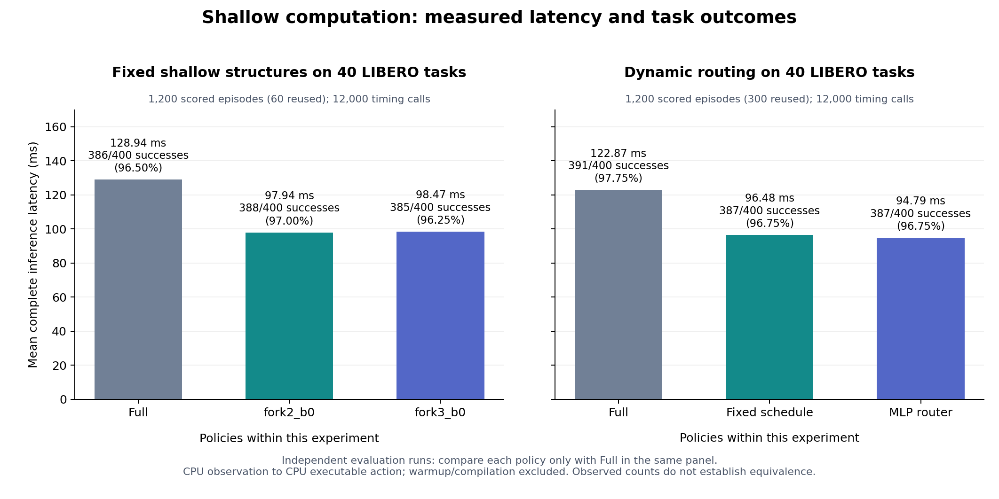
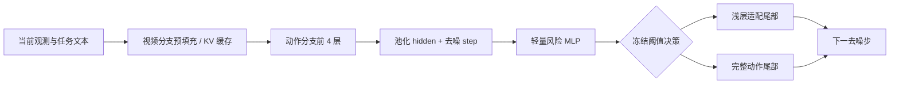

# FastWAM Efficient Routing

**具身策略模型的浅层蒸馏、动态选路与可复核评测**

A research portfolio on shallow action branches, step-wise routing, and the latency–success trade-off of FastWAM policies on LIBERO.

本仓库整理一个围绕机器人策略推理延迟的实验项目：分析视频 KV 缓存与动作去噪路径，比较浅层结构与动态选路，并通过内容输入消融和扰动测试检查方法的适用范围。FastWAM 骨干来自[官方项目](https://github.com/hollowyyy/fastwam)；本项目是基于它的实验扩展。

## 主要结果

以下是**两轮独立的 40 任务实验**，每个方法评估 400 回合。每一行都使用本轮自己的 Full 基线；成功率为样本点估计，不代表无损或等效性证明。

| 实验 | 方案 | 成功数 | 完整推理均值 | 相对本轮 Full |
|---|---|---:|---:|---:|
| 固定浅层结构 | Full | 386/400 | 128.94 ms | 1.00× |
| 固定浅层结构 | fork2_b0 | 388/400 | 97.94 ms | 1.32× |
| 固定浅层结构 | fork3_b0 | 385/400 | 98.47 ms | 1.31× |
| 动态路由 | Full | 391/400 | 122.87 ms | 1.00× |
| 动态路由 | fixed4 | 387/400 | 96.48 ms | 1.27× |
| 动态路由 | MLP | 387/400 | 94.79 ms | 1.30× |

完整推理指 **CPU 观测到 CPU 可执行动作**，排除预热和编译；不是并行闭环的单回合耗时。固定浅层方案延迟降低约 **24.0%**；动态 MLP 方案降低约 **22.9%**，对应样本成功率降低 **1 个百分点**。固定结构实验包含 60 个复用回合；动态实验包含 300 个复用回合。



数据：[聚合结果](results/summary.json) · [来源摘要与哈希](results/provenance.json) · [实验清单](docs/experiments.md)

## 实现与实验思路



这张图对应后期 **Task4 content60** 组件。锚点步直接使用 Full；其余 eligible 步选择固定浅层分支或 Full。它不是每步任意选择一个不同层数的多出口模型。

- **浅层结构与蒸馏：** 比较分叉深度、适配块和固定调度，评估训练更新次数与学习率。
- **内容路由：** 用动作第 4 层 hidden 预测浅层和 Full 在同一 latent 上的局部 flow 差异。
- **消融：** 对比 content、timestep、meta、随机与 Oracle，检查输入信息、真实浅层比例及路由开销。
- **评测：** 分开记录成功率、浅层率、去噪时间和完整时间；使用配对初态、独立路由 RNG 和独占 GPU 测速。

**版本对应关系：** 本仓库公开的 `routing/` 是后期 Task4 无配额组件。上表动态 40 任务结果来自更早的路由版本。运行这里的组件不能直接复现上表 94.79 ms；两者的范围见[方法说明](docs/method.md)。

## 一分钟运行

基础结果复核与路由演示只需 Python 3.10+，不需要 GPU 或模型下载：

```bash
python scripts/summarize_results.py
python examples/route_demo.py
python -m unittest discover -s tests -v
```

重画结果图：

```bash
python -m pip install -r requirements-plot.txt
python scripts/plot_results.py
```

`route_demo.py` 使用明确标记的合成分数来解释控制流，**不是新增模型实验**。PyTorch MLP 组件需要单独安装 PyTorch；真实检查点未包含在此仓库。

## 复现范围与结论边界

| 内容 | 此仓库提供什么 |
|---|---|
| 结果复核 | 公开聚合数据、统计表生成与绘图脚本 |
| 核心路由 | Task4 的 MLP 输入消融实现、独立 RNG、冻结阈值与随机规则 |
| 完整闭环重跑 | 需要另行准备原模型、浅层与路由检查点、采集数据、环境和 GPU；本仓库尚不提供一键闭环重跑 |

已有实验支持 shallow routing 的加速效果，以及 hidden 对局部 flow-gap 预测的价值。
详细说明：[复现步骤](docs/reproduction.md) · [实验限制](docs/limitations.md) · [上游与来源](THIRD_PARTY.md)

## 仓库结构

```text
routing/       Task4 路由与输入消融组件
examples/      无权重的控制流演示
results/       白名单提取的聚合指标与来源哈希
scripts/       结果检查、表格生成、绘图
tests/         科学协议不变量与聚合数据检查
assets/        由公开数据生成的结果图
docs/          方法、实验版本、复现范围与限制
```

这是研究组件与结果展示仓库，不包含 FastWAM 上游源码、模型权重、服务器配置或原始机器人观测。上游资源分别遵守其许可证；项目级许可证尚待作者确定，详见 `THIRD_PARTY.md`。
